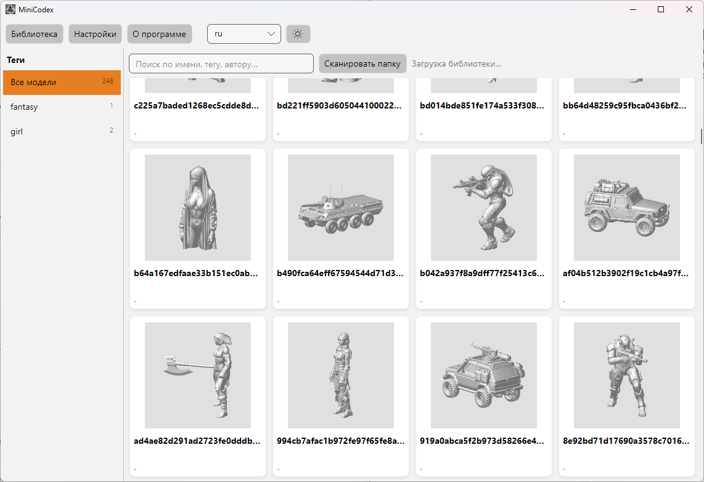
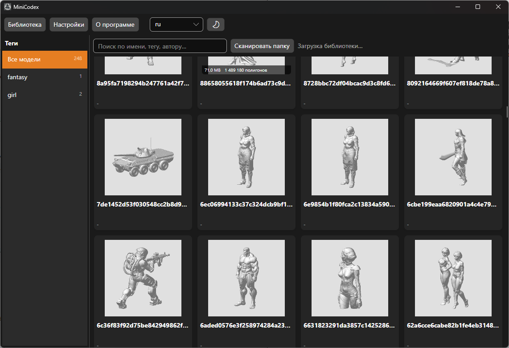
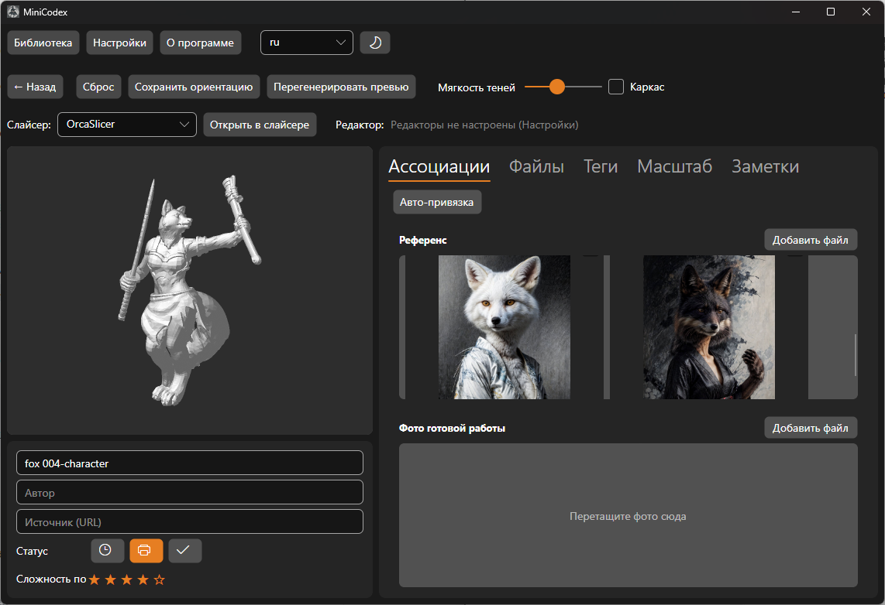
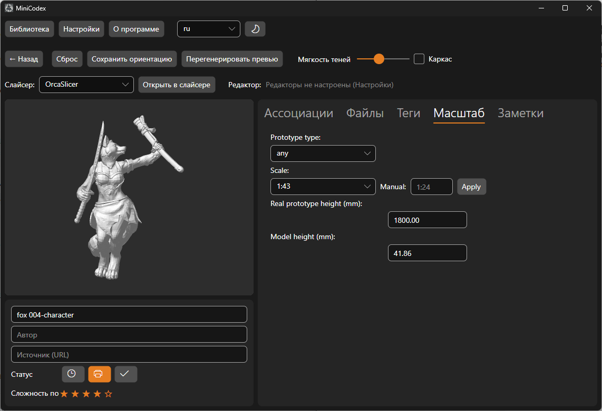
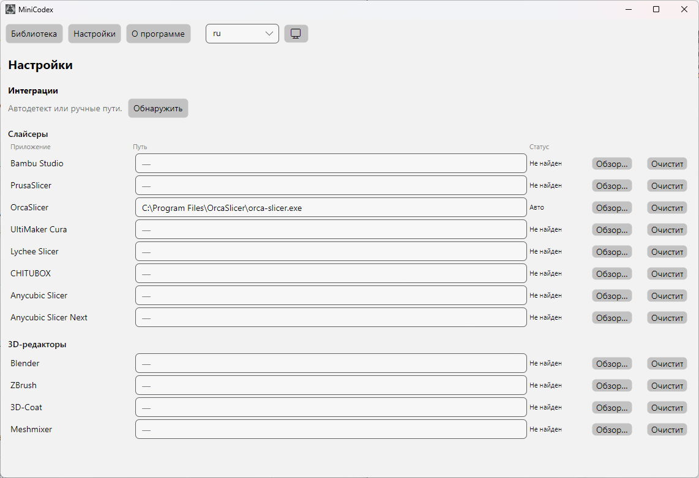

# MiniCodex

**Portable 3D model library for artists, collectors, and 3D printing enthusiasts.**

Status: pre-release (v0.1.0-alpha) | Platform: Windows x64 | License: MIT

MiniCodex is a portable Windows desktop application for cataloging 3D models
(STL, OBJ, 3MF, PLY) with a unified model card, associations (references,
renders, photos of finished work, print profiles), tags, search, built-in
3D viewer, and scale converter.

## Screenshots

### Library (light theme)


### Library (dark theme, hover panel with metadata and rotation)


### Model card - Associations (Reference + Photo)


### Model card - Scale converter


### Settings - Integrations (slicers and 3D editors)


## Features

- **Library grid** with soft shadows, hover metadata (size, polygons, file
  count), 4-angle preview rotation on hover, context menu, double-click to open
- **Incremental scanning** of source folders (by path, size, and modification date)
- **Auto-generated 4-angle previews** cached per model, invalidated by source change
- **Built-in 3D viewer** - drag to rotate, mouse wheel to zoom, wireframe toggle,
  adjustable shadow softness
- **Model card** - unified card with 5 tabs: Associations, Files, Tags, Scale, Notes
- **Associations** - attach reference images and photos of finished work via
  drag-and-drop, auto-link by filename
- **Tags** with usage counts and sidebar filter
- **Search** by name, tag, author, source URL
- **Scale converter** - 43 presets in 7 categories, manual input, bidirectional
  real/model height calculation
- **Integrations** with 12 slicers and 3D editors (Bambu Studio, PrusaSlicer,
  OrcaSlicer, UltiMaker Cura, Lychee, CHITUBOX, Anycubic Slicer, Anycubic
  Slicer Next, Blender, ZBrush, 3D-Coat, Meshmixer) - auto-detect via Registry
  plus manual override
- **Themes** light / dark / auto with amber accent
- **Localization** Russian + English, autodetect by system locale

## Supported formats

STL, OBJ, 3MF, PLY.

ZIP / RAR / 7Z archives are planned for v1.1.

## Portable

MiniCodex does not require installation and does not need admin rights.
All data is stored next to the executable in `./data/`:

- `data/library.db` - SQLite database
- `data/cache/previews/` - preview cache (PNG)
- `data/cache/asset-thumbs/` - association thumbnails
- `data/assets/` - associated files (hybrid storage)

First run creates `data/` automatically.

## Installation

1. Download `MiniCodex-v0.1.0-alpha-win-x64.zip` from the
   [Releases](https://github.com/SantidioEsanti/MiniCodex/releases) page.
2. Extract to any folder (for example `D:\Apps\MiniCodex\`).
3. Run `MiniCodex.exe`.

### First-run note

Windows SmartScreen may warn about an unsigned executable.
Click **More info** -> **Run anyway**. Code signing is planned for a future release.

## System requirements

- Windows 10 or 11, x64
- 100 MB free disk space (plus size of your model library)
- No additional software required (self-contained, .NET runtime bundled)

## Build from source

Requires .NET 8 SDK (or .NET 9 SDK; both build net8.0 targets).

```
git clone https://github.com/SantidioEsanti/MiniCodex.git
cd MiniCodex
dotnet build src/MiniCodex.sln
dotnet test src/MiniCodex.sln
```

### Build portable zip

```
powershell -ExecutionPolicy Bypass -File ".\build-release.ps1"
```

Output: `dist/MiniCodex-v0.1.0-alpha-win-x64.zip`.

## Documentation

- [HANDOFF](docs/HANDOFF.md) - current project state, architecture, patch workflow
- [ROADMAP](docs/ROADMAP.md) - MVP roadmap
- [ARCHITECTURE](docs/ARCHITECTURE.md) - architectural decisions
- [DB_SCHEMA](docs/DB_SCHEMA.md) - database schema
- [UI_UX](docs/UI_UX.md) - screens specification
- [SCALES](docs/SCALES.md) - scale presets table

## Development status

MVP is complete. v0.1.0-alpha is the first pre-release.
See [ROADMAP](docs/ROADMAP.md) for the list of deferred features (v1.1+).

Solo development. Feedback welcome via GitHub Issues.

## Support the author

If MiniCodex is useful to you, you can support the author on
[Boosty](https://boosty.to/santidioesanti).
Completely optional - the project is and will remain free.

## Trademarks

Names of slicers and 3D editors (Bambu Studio, PrusaSlicer, OrcaSlicer, UltiMaker
Cura, Lychee Slicer, CHITUBOX, Anycubic Slicer, Anycubic Slicer Next, Blender,
ZBrush, 3D-Coat, Meshmixer) are property of their respective owners. MiniCodex
is not affiliated with them and does not claim their trademarks. Integrations
work by launching external executables configured by the user.

## License

MIT. See [LICENSE](LICENSE).

Copyright (c) 2026 Santidio Esanti.